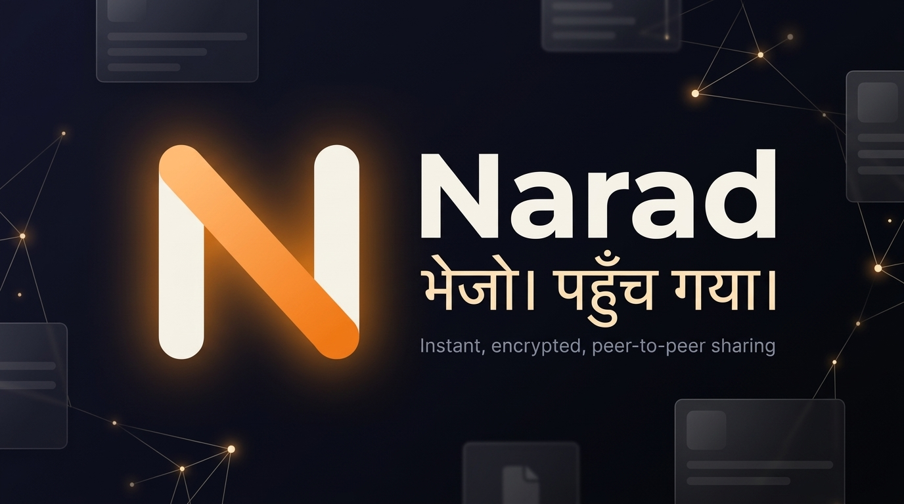
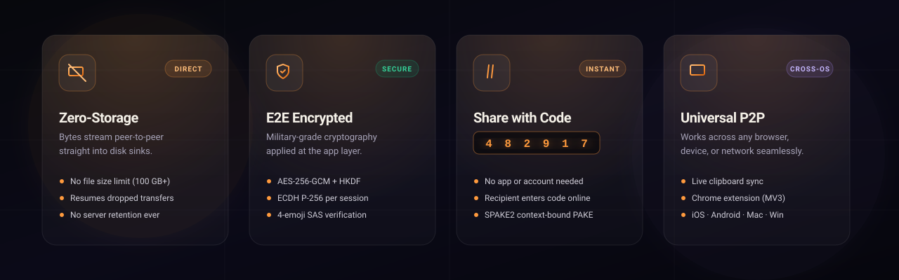
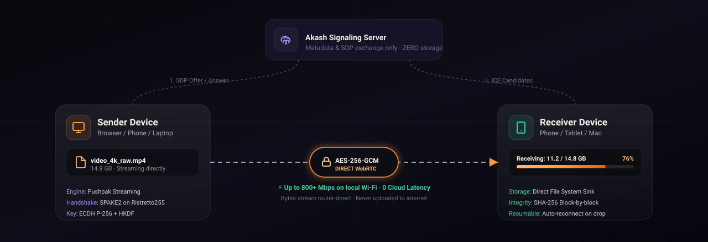

<div align="center">

  

  # Narad (नारद)
  ### *भेजो। पहुँच गया।* — Instant, Zero-Storage Peer-to-Peer Sharing

  [](./LICENSE)
  [](https://github.com/SONUVERMA11/narad)
  [](https://www.typescriptlang.org/)
  [](https://webrtc.org/)
  [](./SECURITY.md)
  [](https://app.narad.sh)

  <p align="center">
    <b>Files of any size &bull; Live clipboard sync &bull; Text &amp; Chat &bull; 6-digit room codes &bull; Zero server storage</b>
  </p>

  <p align="center">
    <a href="https://narad.sh"><strong>Explore Landing Page »</strong></a> &bull;
    <a href="https://app.narad.sh"><strong>Launch Web App »</strong></a> &bull;
    <a href="https://narad.sh/receive"><strong>Receive with Code »</strong></a> &bull;
    <a href="./NARAD-System-Design.md"><strong>System Architecture »</strong></a>
  </p>

  <br />

  <p align="center">
    <a href="https://narad.sh">
      
    </a>
    &nbsp;
    <a href="https://app.narad.sh">
      
    </a>
    &nbsp;
    <a href="https://narad.sh/receive">
      
    </a>
  </p>

</div>

---

## ⚡ Overview

**Narad** is a modern, privacy-first peer-to-peer data transport platform that lets you share files of any size, synchronize clipboards, and exchange end-to-end encrypted messages directly between devices.

* **On the same Wi-Fi:** Bytes travel strictly over your local network router at wire speed. They never hit the public internet.
* **Across the globe:** Secure WebRTC streams traverse NATs with STUN/TURN, authenticated and rendezvoused via a disposable 6-digit code or private space link.
* **Zero cloud storage:** The server only acts as a signaling introduction layer (**Akash**). It never sees your file names, sizes, text, or payload. Everything is encrypted at the application layer with **AES-256-GCM**.

<div align="center">
  
</div>

---

## 🛰️ How It Works (P2P Architecture)

<div align="center">
  
</div>

1. **Signaling Handshake (Akash):** Devices exchange SDP offers and ICE candidates through lightweight WebSockets (Node or Cloudflare Workers). No content ever passes through this channel.
2. **Channel Fingerprint & SPAKE2:** Both devices run **SPAKE2 over ristretto255** bound to the channel fingerprint to thwart man-in-the-middle attacks.
3. **Application-Layer Encryption (Chakra):** A distinct session key is generated via ECDH (Curve P-256) and derived with HKDF-SHA256, encrypting all transfers under AES-256-GCM.
4. **Pushpak Streaming Engine:** Files are read in memory-efficient chunks, transmitted with responsive back-pressure control, and written directly into stream sinks on the receiving machine.

---

## 🚀 Key Features

| Feature | Description |
|---|---|
| **📁 No File Size Limits** | Transfer 50 MB PDFs or 50 GB 4K video shoots with equal ease. Chunks stream straight from disk to wire to disk. |
| **🔄 Auto-Resumable Transfers** | Wi-Fi drops mid-transfer? Both sides freeze state and negotiate `resume-offer → resume-request(fromOffset) → resume-ack` when reconnected. |
| **🔑 Share with 6-Digit Code** | Need to send a file to someone on another computer? Just give them a temporary 6-digit code. They enter it at [`narad.sh/receive`](https://narad.sh/receive) — no app download required. |
| **📋 Background Clipboard Sync** | Real-time clipboard sharing across devices with contact opt-in. Extension captures and applies changes automatically. |
| **🛡️ E2E Cryptography** | Double-layer security: WebRTC DTLS on the wire + application-layer AES-256-GCM + SAS 4-emoji visual verification. |
| **🏢 Spaces & Contacts** | "Office mode" private rooms with cryptographic URL fragments, plus local-device contacts that require zero centralized account lists. |
| **🧩 Chrome Extension (MV3)** | Lives in an offscreen document (`WEB_RTC` reason) so connections stay alive indefinitely without background sleep timeouts. |
| **💼 Team Licensing & Billing** | Ed25519/ES256 signed JWT capability tickets, Razorpay webhook integration, and scalable Cloudflare Durable Objects. |

---

## 📦 Monorepo Structure

Narad is organized as a high-performance **pnpm monorepo**:

```plaintext
narad/
├── packages/
│   ├── core/           # Framework-free TypeScript engine: Setu (WebRTC), Chakra (Crypto), Pushpak (Streaming), Sanjay (Signaling)
│   ├── icons/          # Shared SVG iconography (<Icon name="..." />) for web & extension
│   └── license/        # ES256 JWT team licensing mint & verify engine
├── apps/
│   ├── web/            # Modern PWA UI (Vite + React 19 + Tailwind CSS + Lucide)
│   ├── signaling/      # Akash signaling server (Dual Node.js & Cloudflare Durable Objects)
│   ├── extension/      # Chrome Manifest V3 extension with offscreen WebRTC worker
│   ├── site/           # Fast static landing page with light/dark theme & localized Hindi/English
│   └── billing/        # Cloudflare Worker for automated Razorpay checkouts & license generation
├── infra/
│   ├── selfhost/       # Docker Compose + Caddy with automatic TLS reverse-proxy
│   └── turn/           # Coturn relay configuration for restrictive enterprise firewalls
├── e2e/                # Playwright end-to-end multi-browser WebRTC integration test suite
└── .github/            # Workflows (CI/CD) and repository design assets
```

---

## 🛠️ Tech Stack & Design System

### Technology
* **Frontend:** React 19, TypeScript, Tailwind CSS, Vite, Service Worker PWA
* **Core Engine:** WebRTC DataChannels, Web Cryptography API (`SubtleCrypto`), SPAKE2 (`@noble/curves`), Streams API
* **Backend:** Node.js, `ws`, Cloudflare Workers, Durable Objects, KV
* **Testing:** Vitest (unit & integration), Playwright (multi-browser E2E)
* **Packaging & Tools:** pnpm workspaces, ESLint, TypeScript Base Configs

### Design System: *"Nishā + Kesar"*
* **Night Canvas (`#06060d` / `#0b0a18`):** Deep, distraction-free surfaces with subtle frosted-glass overlays.
* **Kesar Flame (`#ff9a3d` → `#d9640f`):** Amber/saffron energetic accents representing the divine message flow.
* **Neel Accent (`#a78bfa`):** Soft violet cues for spaces, pairing sessions, and security verification.
* **Typography:** Manrope (Variable geometric sans) + Noto Sans Devanagari + Instrument Serif.

---

## 💻 Getting Started Locally

### Prerequisites
* **Node.js**: `v20.0.0` or higher (Tested on `v22` & `v26`)
* **pnpm**: `v9.12.0` (`npm install -g pnpm@9.12.0` or via Corepack)
* **Git**: Installed and available in PATH

### 1. Clone the repository
```bash
git clone https://github.com/SONUVERMA11/narad.git
cd narad
```

### 2. Install workspace dependencies
```bash
pnpm install
```

### 3. Start local development
```bash
# Starts signaling server (ws://localhost:8794/ws) and web app (http://localhost:5173) in parallel
pnpm dev
```

* **Web Application:** Open [http://localhost:5173](http://localhost:5173)
* **Signaling Health:** Open [http://localhost:8794/health](http://localhost:8794/health)

> **Windows PowerShell Tip:** If your environment does not accept inline Unix environment variables, run:
> ```powershell
> $env:NARAD_PORT="8794"; pnpm dev
> ```

---

## 🧪 Testing & Verification

Narad maintains a rigorous test suite covering cryptographic primitives, resumable chunking, and signaling rate-limits.

```bash
# Run all unit test suites (core crypto, PAKE, signaling, licensing)
pnpm test

# Run type checks across all workspace packages
pnpm typecheck

# Run end-to-end Playwright tests with real browser WebRTC
pnpm e2e
```

**Unit Test Breakdown (39/39 passing):**
* `packages/core`: Contacts, Chakra P-256 Crypto, SPAKE2 Pairing, Pushpak Chunking, Resumable file transfer across dropped connections
* `packages/license`: ES256 cryptographic verification & tamper testing
* `apps/signaling`: Room lifecycle, message validation, token bucket rate limits, ICE negotiation
* `apps/billing`: Razorpay webhook signature validation & license generation

---

## 🔒 Security Model

* **Wire Security:** WebRTC standard DTLS encapsulation.
* **Payload Encryption:** Application-level AES-256-GCM with distinct keys derived via ephemeral ECDH (P-256) per session.
* **MITM Defense:** Out-of-band SAS (Short Authentication String) 4-emoji comparison fingerprint.
* **Zero Persistence:** Signaling servers operate stateless in memory. Neither payloads nor filenames ever touch a disk or database.
* **Device Identity:** Hardware-backed non-extractable ECDSA device identity keys persisted securely in client IndexedDB.

Detailed threat analysis and formal cryptography specifications are documented in [**`SECURITY.md`**](./SECURITY.md).

---

## 🚢 Production Deployment

Narad is architected to deploy easily to global edge platforms or self-hosted servers:

* **Static Web & Site:** Cloudflare Pages, Vercel, or Netlify (`pnpm --filter @narad/web build`)
* **Signaling Server:** Cloudflare Workers with Durable Objects (`pnpm --filter @narad/signaling deploy:cf`) or Docker container on VPS (`apps/signaling/Dockerfile`)
* **Self-Hosted Complete Stack:** One-command Docker Compose with automatic Let's Encrypt TLS in [`infra/selfhost`](./infra/selfhost)

Refer to [**`GO-LIVE.md`**](./GO-LIVE.md) and [**`infra/DEPLOY.md`**](./infra/DEPLOY.md) for full deployment instructions.

---

## 👨‍💻 Developed By

**Sonu Verma**  
* GitHub: [@SONUVERMA11](https://github.com/SONUVERMA11)  
* Repository: [https://github.com/SONUVERMA11/narad](https://github.com/SONUVERMA11/narad)  
* Live Platform: [https://narad.sh](https://narad.sh)

---

## 📄 License

This project is licensed under the [MIT License](./LICENSE). Feel free to use, modify, and distribute.
